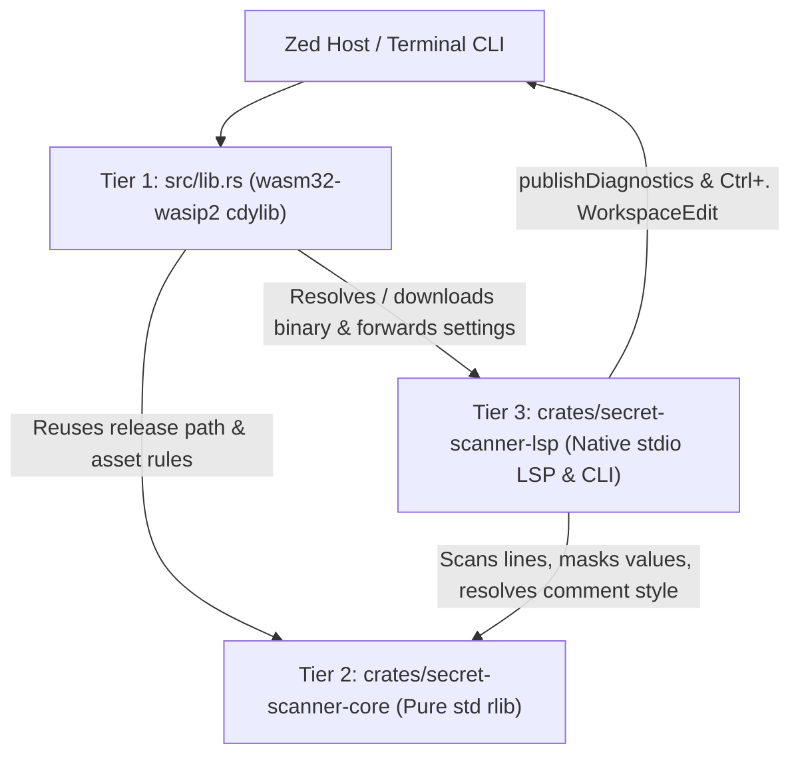

# Architecture Specification — zed-secret-scanner

> **Inspired by**: [gitleaks/gitleaks](https://github.com/gitleaks/gitleaks) (MIT) — independent pure-Rust reimplementation with no external regex crate or upstream source/binary dependencies.
> **Target Runtime**: Zed Editor Extension (`secret-scanner-lsp`), compiled to WebAssembly (`wasm32-wasip2`, `zed_extension_api = "0.7.0"`) plus a native stdio LSP & CLI sidecar (`secret-scanner-lsp`).

---

## 1. 3-Tier Hybrid Architecture

`zed-secret-scanner` cleanly separates the Zed WASM host boundary from pure domain logic and the native stdio language server:

### Runtime & Capability Comparison

| Dimension | Traditional CLI Secret Scanner (`gitleaks`) | `zed-secret-scanner` (`secret-scanner-lsp`) | Architectural Impact |
|---|---|---|---|
| **Execution Host** | Manual terminal / pre-commit / CI runs | WASI 0.2 extension (`wasm32-wasip2`) + persistent native `secret-scanner-lsp` sidecar + optional `secret-scanner-lsp scan` CLI | Immediate editor squiggles as you type, plus CI/task CLI parity using the same rules |
| **Regex Engine** | Go RE2 engine over rule config | Hand-written ASCII byte/prefix/charset & structural matchers + Shannon entropy in pure `std` | Zero external dependencies in Tier 2 (`secret-scanner-core`), sub-millisecond line scans, instant host `cargo test` |
| **Suppression UX** | Manual `# gitleaks:allow` edits | `Ctrl+.` Quick Fix inserts language-aware indented `secret-scanner-lsp:ignore-next-line` (while honoring `gitleaks:allow`) | One-keystroke suppression across 40+ languages |
| **Secret Safety** | Redaction configurable per output format | Mandatory `mask_secret` inside `secret-scanner-core` before building `Finding::message()` | Raw secret plaintext never enters LSP diagnostics, quick-fix titles, or CLI reports |

---

## 2. Detection & Diagnostic Pipeline

1. **Path & Binary Gate (`paths.rs`, `workspace.rs`)**:
   - Skips `.git`, `node_modules`, `target`, build directories, lockfiles (`Cargo.lock`, `package-lock.json`, etc.), minified assets, binary extensions, user `ignorePaths` globs, files over `maxFileSize` (1 MiB default), and files containing NUL bytes in the first 8 KiB.
2. **Inline Suppression Pass (`allow.rs`, `scanner.rs`)**:
   - Tracks `secret-scanner-lsp:ignore-next-line` across lines and `secret-scanner-lsp:ignore` / `gitleaks:allow` on the active line.
3. **Specific Rule Pass (`rules.rs`)**:
   - Runs 24 prefixed provider token matchers and 5 structural matchers (`private-key`, `azure-storage-account-key`, `hashicorp-tf-api-token`, `jwt`, `url-credentials`) with word-boundary checks and documentation-password exclusions.
4. **Keyword + Entropy Pass (`entropy.rs`)**:
   - On lines up to 4096 bytes (skipping minified bundles), inspects `key = value` / `key: value` / `key := value` / `'key' => 'value'` assignments whose normalized key contains a credential keyword (and does not end with a metadata suffix like `_url`, `_id`, `_hash`) and whose value meets `entropy_min_length` (12) and `entropy_threshold` (3.5 bits/char), while filtering placeholders, regexes, prose, and unquoted code expressions.
   - Specific rules take priority on overlapping spans so a `github-pat` is never double-reported as `generic-api-key`.
5. **Masking & UTF-16 LSP Projection (`mask.rs`, `position.rs`, `convert.rs`)**:
   - Converts byte ranges into UTF-16 code-unit ranges and builds masked messages (`<prefix>…(<len> chars)`).

---

## 3. Binary Resolution & Shutdown Discipline

- **Exact-Version Download (`release.rs`, `src/lib.rs`)**:
  - Checks `lsp.secret-scanner-lsp.binary.path` -> `worktree.which("secret-scanner-lsp")` -> cached `secret-scanner-lsp-v<VERSION>/` -> `zed::github_release_by_tag_name` for `v<CARGO_PKG_VERSION>`.
  - Cleans stale version directories after a successful download and falls back to the newest cached directory (`newest_version_dir`) when offline.
- **Deterministic LSP Exit (`server.rs`)**:
  - Dropping `Server` (which holds a cloned `Sender<Message>`) and `Connection` before `io_threads.join()` ensures the stdout writer thread terminates cleanly on `shutdown`/`exit` without hanging.
- **Zed Extension API 0.7.0 Constraints**:
  - `extension.toml` uses scoped `download_file` capabilities only (no `process:exec`, no `[slash_commands.*]`, no custom WebViews).
  - Because secrets can be committed in almost any text file, `[language_servers.secret-scanner-lsp]` lists common source, config, and documentation languages; Zed ignores any listed language that has no grammar installed.
